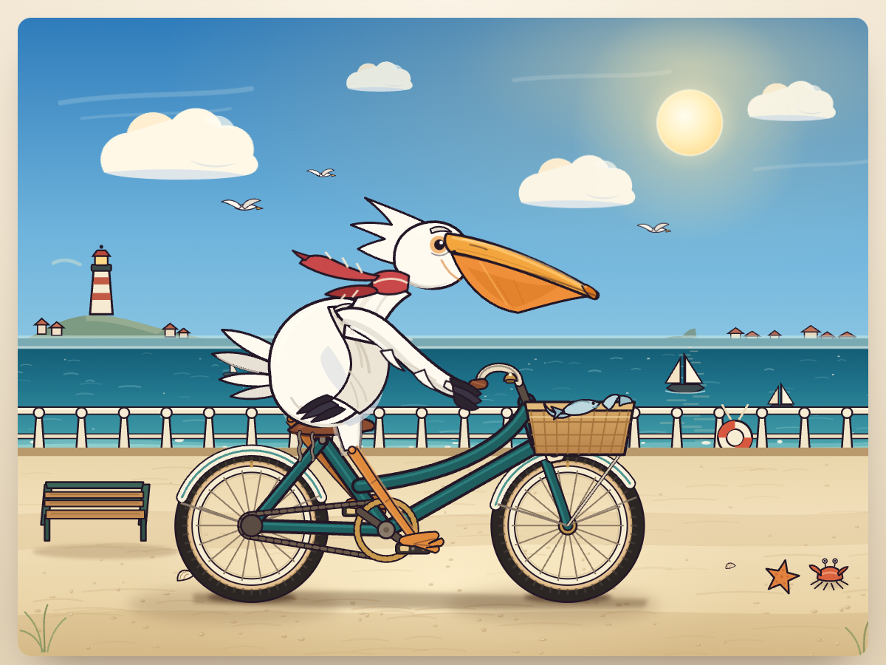

# Pelican on a Bicycle

A single-scene illustration in **HTML + inline SVG only**. No JavaScript, no
external images, fonts or libraries — open `index.html` from disk and it runs.



## Files

| File | What it is |
| --- | --- |
| `index.html` | The deliverable. A page with the whole scene inline, 1 self-contained file. |
| `pelican.svg` | The same artwork as a bare SVG (no page chrome), for embedding or converting. |
| `tools/build.py` | The drawing bench. Geometry, the pedalling solve and every SMIL track live here; the two files above are generated from it. |
| `preview/` | Renders: `poster.png` (browser, t = 0), `anim_sheet.png` (four crank phases), `mobile.png` (390 px wide). |

## What moves

All animation is SMIL (`<animate>` / `<animateTransform>`) inside the SVG:

- wheels, chainring, crank arms, chain — one continuous drivetrain
- **two-bone IK legs** — a 24-keyframe solve from the hip to the ankle, so the
  webbed feet stay planted on the pedals for the whole crank revolution
  (thigh, shank, foot, joint and pedal all follow the same solve)
- scarf tails, head sway, wing and body breathing
- bell ding, fish in the basket, sea glitter, gulls, bobbing boats, rolling surf

## Rebuild

```bash
cd tools
python build.py                        # writes ../pelican.svg and ../index.html
python build.py --frame 0.6 --png ../preview/frame.png   # needs resvg-py
```

`--frame` renders a still at a given time so a phase can be inspected. Times are
seconds; the crank cycle is `CRANK_DUR = 2.4 s`.

## Notes on the geometry

- Canvas 1200 × 900, wheels `R = 98`, bottom bracket `(520, 722)`, crank `r = 46`.
- Hip `(462, 522)`, thigh `88`, shank `150`. The knee folds **backwards**, the way
  a bird's hock does, so it stays tucked under the belly instead of swinging out
  into open sky.
- The far leg is drawn behind the frame, the near leg in front of it.
- Palette, stroke weight and the ink colour (`#241726`) are fixed at the top of
  `build.py`.
